# Catálogo de Cine — CRUD con Spring Boot, JPA y PostgreSQL

Aplicación web y API REST desarrollada con **Spring Boot**, **Spring Data JPA**, **Thymeleaf** y **PostgreSQL** para gestionar un catálogo de **Películas** y **Directores** mediante una relación uno a muchos (`@OneToMany` / `@ManyToOne`).

---

## Tecnologías Utilizadas

- **Java 21**
- **Spring Boot 4.1.2** 
- **PostgreSQL** 
- **Bootstrap 5.3.2** 
- **Maven** 

---

## Entidades Relacionadas

El proyecto implementa dos entidades JPA relacionadas entre sí:

1. **`Director`** (`tabla: directores`)
   - `id` (`Long`, llave primaria autoincremental)
   - `nombre` (`String`)
   - `nacionalidad` (`String`)
   - `peliculas` (`List<Pelicula>`, relación `@OneToMany(mappedBy = "director", cascade = CascadeType.ALL)`)

2. **`Pelicula`** (`tabla: peliculas`)
   - `id` (`Long`, llave primaria autoincremental)
   - `titulo` (`String`)
   - `genero` (`String`)
   - `anio` (`Integer`)
   - `director` (`Director`, relación `@ManyToOne` con llave foránea `@JoinColumn(name = "director_id")`)

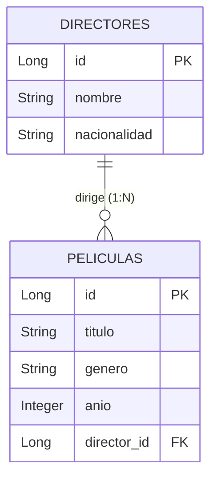

---

## Estructura del Proyecto

```text
src/main/java/com/ale/democrud/
├── DemocrudApplication.java
├── controllers/
│   ├── PeliculaController.java      
│   └── PeliculaRestController.java  
├── models/
│   ├── Director.java                
│   └── Pelicula.java                
├── repository/
│   ├── DirectorRepository.java
│   └── PeliculaRepository.java
└── services/
    ├── DirectorService.java
    └── PeliculaService.java

src/main/resources/
├── application.properties           
└── templates/
    ├── index.html                   
    └── form.html                    
```

---


## Rutas Disponibles

### Vistas Web (`PeliculaController`)

| Método | Ruta | Descripción |
| :--- | :--- | :--- |
| `GET` | `/` | Muestra el catálogo de películas, la lista de directores y el formulario para agregar un director (`index.html`). |
| `GET` | `/nuevo` | Muestra el formulario para registrar una nueva película (`form.html`). |
| `POST` | `/guardar` | Guarda una película nueva o actualiza una existente y redirige a `/`. |
| `POST` | `/directores/guardar` | Guarda un nuevo director y redirige a `/`. |
| `GET` | `/editar/{id}` | Carga los datos de la película seleccionada en `form.html`. |
| `GET` | `/eliminar/{id}` | Elimina la película por su ID y redirige a `/`. |

### API REST (`PeliculaRestController` — `/api`)

| Método | Endpoint | Descripción |
| :--- | :--- | :--- |
| `GET` | `/api/peliculas` | Lista todas las películas incluyendo el objeto `director` completo. |
| `GET` | `/api/peliculas/{id}` | Consulta una película por ID junto con la información de su director. |
| `POST` | `/api/peliculas` | Crea una nueva película asociada a un `director.id`. |
| `PUT` | `/api/peliculas/{id}` | Actualiza una película existente y su director. |
| `DELETE` | `/api/peliculas/{id}` | Elimina una película por ID. |
| `GET` | `/api/directores` | Lista todos los directores registrados. |
| `POST` | `/api/directores` | Registra un nuevo director. |

---

## CRUD y Relación Funcionando

### 1. Relación Reflejada Correctamente (`Pelicula` → `Director`)

Al consultar las películas en la vista principal (`/`) o mediante el endpoint `GET /api/peliculas`, no se muestra únicamente el `director_id`, sino los datos completos de la entidad relacionada: el **nombre del director** y su **nacionalidad**. De igual forma, en el formulario `form.html`, la selección de director se realiza mediante una lista desplegable con los nombres y nacionalidades de los directores registrados.

> **[Relación reflejada correctamente (mostrando el nombre y nacionalidad del Director junto a cada Película, en la web y/o respuesta JSON de `/api/peliculas`)]**
>
> 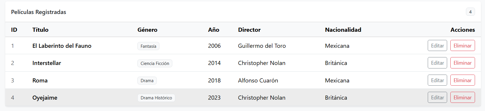
> 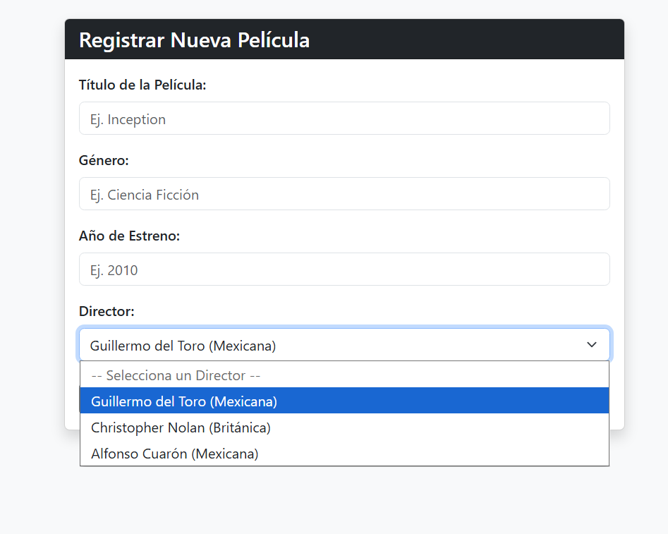

---

### 2. Operación CREAR (Create)

Registro de un nuevo **Director** desde la vista principal (`POST /directores/guardar`) y creación de una nueva **Película** mediante `form.html` (`POST /guardar`), seleccionando al director desde la llave foránea.

> **[Creación de un nuevo Director y/o formulario de Nueva Película]**
>
> 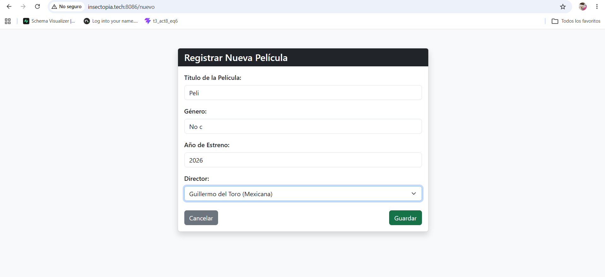
> 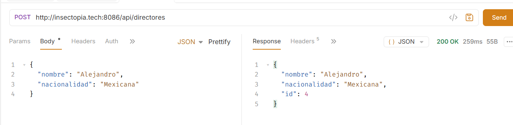

---

### 3. Operación LEER (Read)

Visualización de los registros almacenados en PostgreSQL desde `index.html` (`GET /`) o mediante consulta a la API REST (`GET /api/peliculas` / `GET /api/peliculas/{id}`), mostrando los nuevos registros creados.

> **[Listado de películas y directores funcionando (operación Leer)]**
>
> 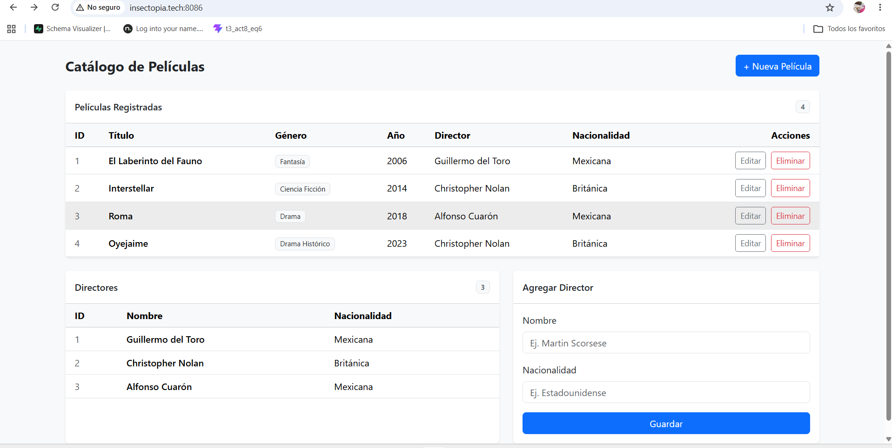
> 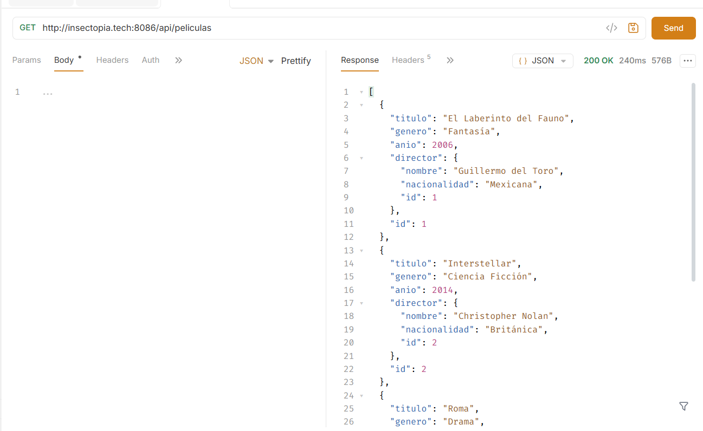

---

### 4. Operación ACTUALIZAR (Update)

Edición de una película existente desde `/editar/{id}` (`form.html`) o vía `PUT /api/peliculas/{id}`, modificando sus campos (título, género, año o director asignado) y comprobando el cambio en el listado.

> **[Formulario de edición y registro actualizado en la tabla]**
>
> 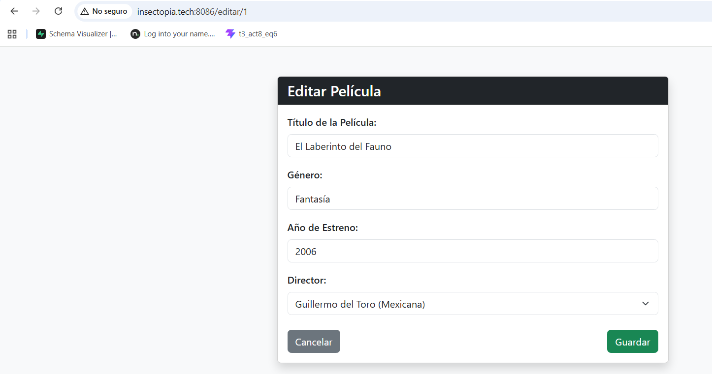
> 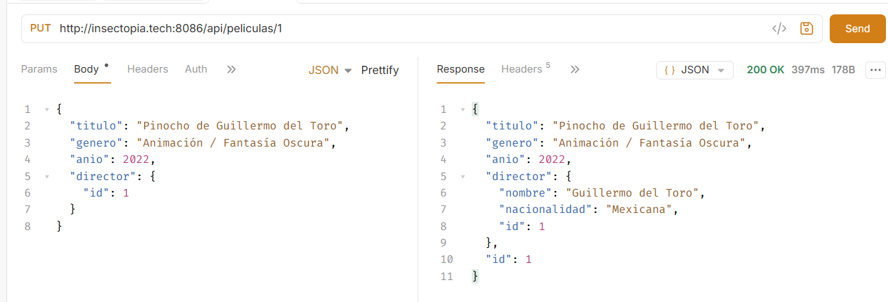

---

### 5. Operación ELIMINAR (Delete)

Eliminación de una película desde el botón **Eliminar** (`/eliminar/{id}`, con diálogo de confirmación) o mediante `DELETE /api/peliculas/{id}`, verificando que el registro desaparece del catálogo y de la base de datos.

> **[Confirmación de eliminación y tabla actualizada tras eliminar]**
>
> 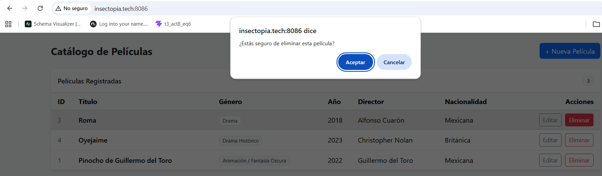
> 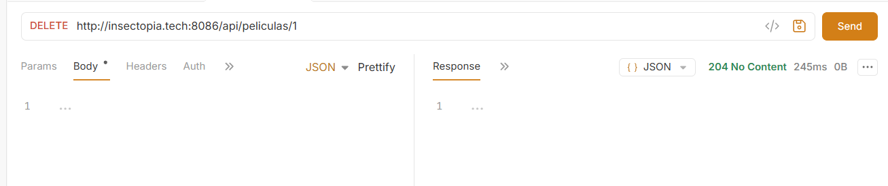
