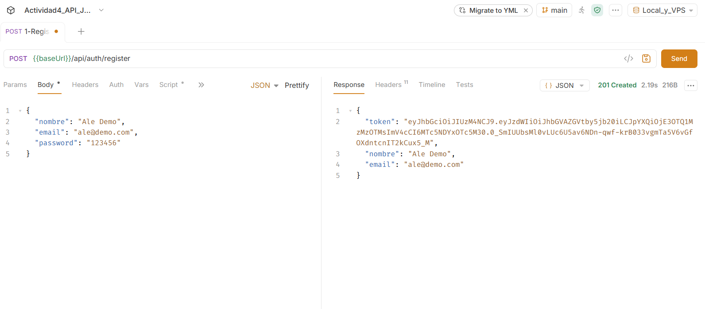
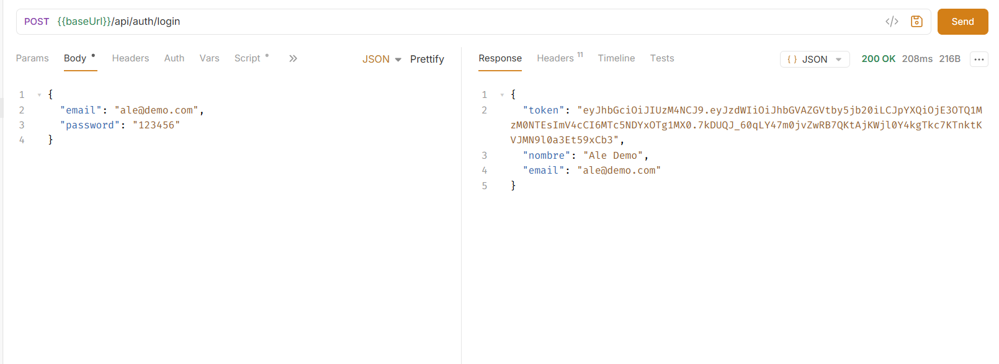
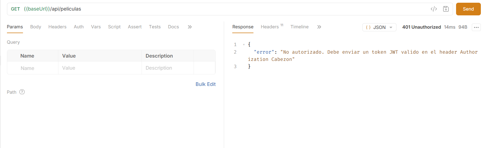
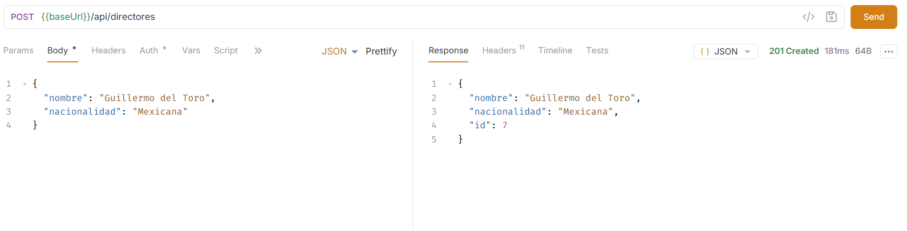
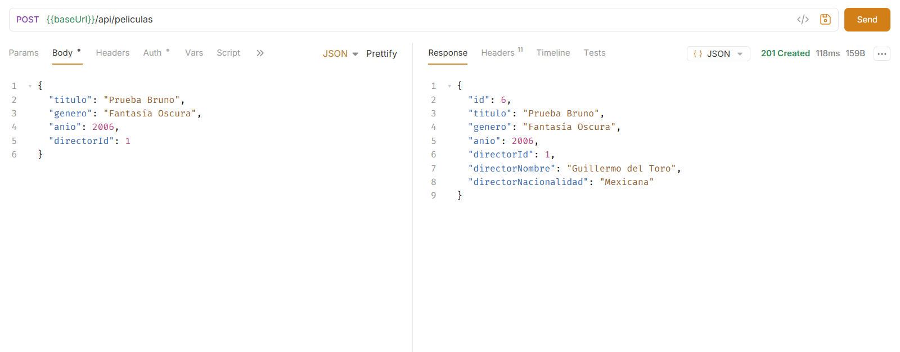
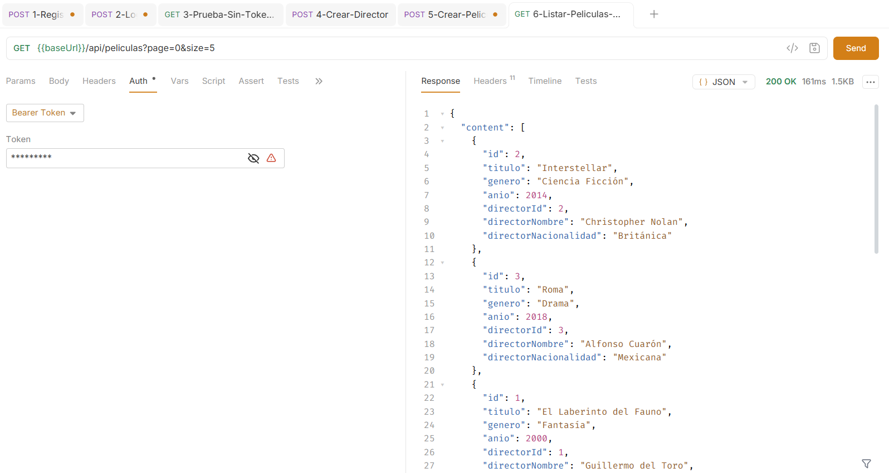
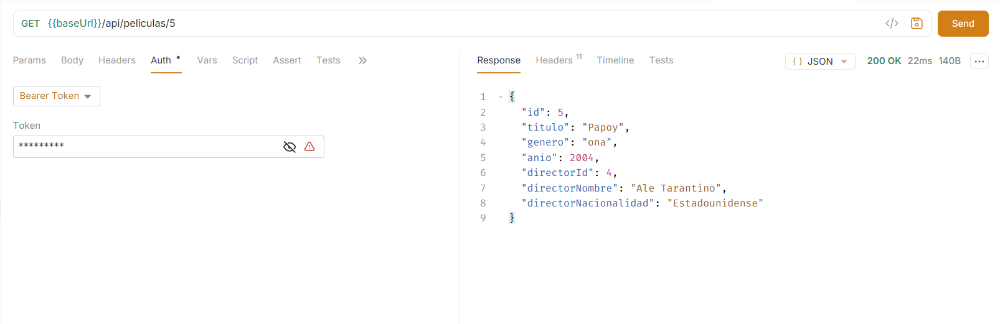
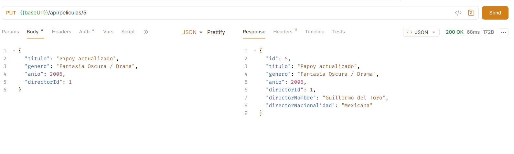
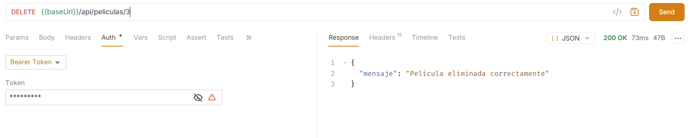

# Actividad 4 — API REST con Spring Boot, Spring Security y JWT


**Repositorio:** `AJVact4_t4`  
**Autor:** Alejandro Victoriano (`AJV`)  
**Asignatura:** Programacion Web
**Tema:** API REST pura con autenticación real basada en JWT


---

## Tecnologías y Herramientas

| Componente | Tecnología / Versión | Descripción |
| :--- | :--- | :--- |
| **Lenguaje** | Java 21 LTS | Plataforma base de desarrollo |
| **Framework** | Spring Boot 3.4.1 | Framework principal para la construcción del backend |
| **Seguridad** | Spring Security 6 | Filtros de seguridad, encriptación BCrypt y arquitectura Stateless |
| **Tokens** | JJWT (io.jsonwebtoken) 0.12.6 | Generación, firmado HMAC-SHA256 y validación de tokens JWT |
| **Validación** | Hibernate Validator (`jakarta.validation`) | Validación declarativa de DTOs de entrada con `@Valid` |
| **Base de Datos** | PostgreSQL 16 | Almacenamiento relacional de usuarios, directores y películas |
| **Pruebas API** | Bruno (`bruno.io`) | Cliente API de código abierto con colecciones versionadas |

---

## Arquitectura y Estructura del Proyecto

El proyecto sigue una arquitectura en capas desacoplada y modular:

```text
src/main/java/com/ale/democrud/
├── DemocrudApplication.java
├── controllers/
│   ├── AuthController.java
│   ├── GlobalExceptionHandler.java
│   └── PeliculaRestController.java
├── dtos/
│   ├── AuthResponseDTO.java
│   ├── LoginRequestDTO.java
│   ├── PeliculaRequestDTO.java
│   ├── PeliculaResponseDTO.java
│   └── RegisterRequestDTO.java
├── models/
│   ├── Director.java
│   ├── Pelicula.java
│   └── Usuario.java
├── repository/
│   ├── DirectorRepository.java
│   ├── PeliculaRepository.java
│   └── UsuarioRepository.java
├── security/
│   ├── JwtAuthenticationFilter.java
│   ├── JwtService.java
│   └── SecurityConfig.java
└── services/
    ├── DirectorService.java
    └── PeliculaService.java

src/main/resources/
└── application.properties
```


## Catálogo de Endpoints de la API REST

### 1. Autenticación (`/api/auth`)

| Método | Endpoint | Acceso | Código HTTP | Descripción |
| :---: | :--- | :---: | :---: | :--- |
| `POST` | `/api/auth/register` | Público | `201 Created` / `400 Bad Request` | Registra un usuario y retorna su token JWT inicial. |
| `POST` | `/api/auth/login` | Público | `200 OK` / `401 Unauthorized` | Autentica credenciales y retorna un token JWT válido. |

### 2. Catálogo de Películas — CRUD Protegido (`/api/peliculas`)

*Todos estos endpoints requieren cabecera `Authorization: Bearer <token>`.*

| Método | Endpoint | Parámetros / Body | Código HTTP | Descripción |
| :---: | :--- | :--- | :---: | :--- |
| `GET` | `/api/peliculas` | `?page=0&size=5` (Query Params) | `200 OK` / `401 Unauthorized` | Lista películas con **paginación** usando `Pageable`. |
| `GET` | `/api/peliculas/{id}` | `id` (Path Variable) | `200 OK` / `404 Not Found` | Obtiene el detalle individual de una película por su ID. |
| `POST` | `/api/peliculas` | `PeliculaRequestDTO` (JSON) | `201 Created` / `400 Bad Request` | Crea una nueva película validada con `@Valid`. |
| `PUT` | `/api/peliculas/{id}` | `id` + `PeliculaRequestDTO` | `200 OK` / `400 Bad Request` / `404` | Actualiza los datos de una película existente. |
| `DELETE` | `/api/peliculas/{id}` | `id` (Path Variable) | `200 OK` / `404 Not Found` | Elimina una película por su ID. |
| `GET` | `/api/directores` | Ninguno | `200 OK` / `401 Unauthorized` | Lista los directores registrados. |
| `POST` | `/api/directores` | `Director` (JSON) | `201 Created` / `401 Unauthorized` | Registra un nuevo director. |

---

## Evidencias de Pruebas con Bruno

> [!NOTE]
> Las pruebas fueron ejecutadas con el cliente **Bruno** (`bruno.io`). Las 9 capturas de la carpeta `screenshots/` corresponden, en orden, a la ejecución de los 9 archivos `.bru` de la carpeta `bruno/`: registro, login, prueba sin token y las operaciones del CRUD.

| # | Archivo Bruno | Petición | Captura |
| :---: | :--- | :--- | :--- |
| 1 | `1-Registro.bru` | `POST /api/auth/register` | `01-registro.png` |
| 2 | `2-Login.bru` | `POST /api/auth/login` | `02-login.png` |
| 3 | `3-Prueba-Sin-Token-401.bru` | `GET /api/peliculas` sin token | `03-No token.png` |
| 4 | `4-Crear-Director.bru` | `POST /api/directores` | `04-crear_director.png` |
| 5 | `5-Crear-Pelicula.bru` | `POST /api/peliculas` | `05-Crear_pelicula.png` |
| 6 | `6-Listar-Peliculas-Paginado.bru` | `GET /api/peliculas?page=0&size=5` | `06-listarPeliPaginado.png` |
| 7 | `7-Obtener-Pelicula-ID.bru` | `GET /api/peliculas/1` | `07-ObtenerPorID.png` |
| 8 | `8-Actualizar-Pelicula.bru` | `PUT /api/peliculas/1` | `08-actualizarPeli.png` |
| 9 | `9-Eliminar-Pelicula.bru` | `DELETE /api/peliculas/1` | `09-eliminarPeli.png` |

### 1. Registro de usuario (`POST /api/auth/register`)

Registro de una nueva cuenta mediante `RegisterRequestDTO`. La API cifra la contraseña con BCrypt y devuelve `201 Created` con el token JWT generado en `AuthResponseDTO`, sin exponer la contraseña.

> **[Captura: Registro exitoso con respuesta HTTP 201 Created y token JWT generado]**
>
> 

---

### 2. Inicio de sesión (`POST /api/auth/login`)

Autenticación con email y contraseña válidos. La API verifica el hash con BCrypt y retorna `200 OK` con el token JWT firmado, que se usará como Bearer Token en las peticiones protegidas.

> **[Captura: Login exitoso con respuesta HTTP 200 OK y token JWT retornado]**
>
> 

---

### 3. Endpoint protegido sin token (`GET /api/peliculas`)

Petición al CRUD sin enviar la cabecera `Authorization`. La API rechaza la solicitud con `401 Unauthorized`, confirmando que los endpoints están protegidos.

> **[Captura: Petición sin token rechazada con HTTP 401 Unauthorized]**
>
> 

---

### 4. Crear director (`POST /api/directores`)

Petición protegida con `Authorization: Bearer <token>`. Se registra un director para poder asociarlo posteriormente a una película. Retorna `201 Created`.

> **[Captura: Creación de director con Bearer Token retornando HTTP 201 Created]**
>
> 

---

### 5. Crear película (`POST /api/peliculas`)

Petición protegida con el Bearer Token y el cuerpo validado mediante `PeliculaRequestDTO`. Devuelve `201 Created` con los datos de la película y su director mapeados a `PeliculaResponseDTO`.

> **[Captura: Creación de película con Bearer Token retornando HTTP 201 Created]**
>
> 

---

### 6. Listar películas con paginación (`GET /api/peliculas?page=0&size=5`)

Consulta protegida con el Bearer Token y los parámetros de paginación `page` y `size`. Retorna `200 OK` con el objeto `Page`, incluyendo la lista de películas y los datos de paginación.

> **[Captura: Listado paginado de películas retornando HTTP 200 OK]**
>
> 

---

### 7. Obtener película por ID (`GET /api/peliculas/{id}`)

Consulta protegida de un registro puntual por su ID (`GET /api/peliculas/1`). Retorna `200 OK` con los datos del recurso solicitado.

> **[Captura: Consulta individual de película por ID retornando HTTP 200 OK]**
>
> 

---

### 8. Actualizar película (`PUT /api/peliculas/{id}`)

Actualización protegida de los campos de una película existente mediante `PUT`, con el DTO validado y el Bearer Token. Retorna `200 OK` reflejando los cambios.

> **[Captura: Actualización de película con método PUT retornando HTTP 200 OK]**
>
> 

---

### 9. Eliminar película (`DELETE /api/peliculas/{id}`)

Eliminación protegida de una película mediante `DELETE /api/peliculas/1` con Bearer Token. Retorna `200 OK` confirmando la eliminación del registro.

> **[Captura: Eliminación de película con método DELETE retornando HTTP 200 OK]**
>
> 

---

## Uso de la Colección de Bruno

1. Abre el cliente **Bruno**.
2. Selecciona **Open Collection** y abre la carpeta `bruno/` o `Actividad3_CRUD/` ubicada en la raíz de este repositorio.
3. Selecciona el entorno deseado:
   - **Local:** `baseUrl = http://localhost:8088`
   - **VPS:** `baseUrl = http://insectopia.tech:8088`
4. Ejecuta primero la petición de **Login** o **Registro** para obtener el token JWT.
5. Copia el token recibido y configúralo en el Auth de la colección como Bearer Token (o en la variable `token`), lo que permitirá consumir automáticamente todos los endpoints protegidos.

---
